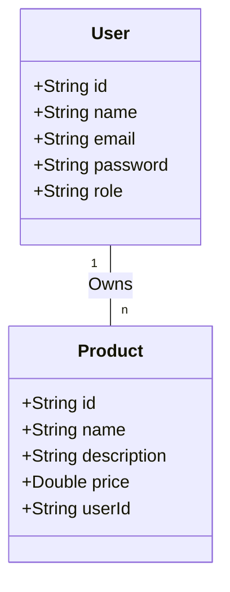

# Let's Play

**Let's Play** is a secure RESTful CRUD API for a small e-commerce-like platform. It manages **users** and **products**: anyone can browse products, registered users create and manage **their own** products, and admins manage **all** users and products.

Authentication uses **JWT** tokens, passwords are hashed with **BCrypt**, data is stored in **MongoDB**, and all traffic goes over **HTTPS**.

## Table of contents

- [Technologies](#technologies)
- [Data model](#data-model)
- [How to run](#how-to-run)
- [Authentication and roles](#authentication-and-roles)
- [API endpoints](#api-endpoints)
- [Examples](#examples)
- [Error handling](#error-handling)
- [Security](#security)
- [Project structure](#project-structure)

## Technologies

| Technology | Version | Used for |
|---|---|---|
| Java | 17+ | Language |
| Spring Boot | 4.1.2 | Application framework, embedded Tomcat server |
| Spring Web MVC | | REST controllers and JSON |
| Spring Data MongoDB | | Repositories and document mapping (`@Document`, `@Id`, `@Field`) |
| Spring Security | | Authentication, URL rules and method security (`@PreAuthorize`, `@PostAuthorize`, `@PermitAll`) |
| JJWT | 0.13.0 | Creating and verifying JWT tokens (HS256) |
| Jakarta Bean Validation | | Input validation (`@NotBlank`, `@Size`, `@Email`, `@Pattern`, ...) |
| BCrypt | | Password hashing and salting |
| MongoDB | 9.0 (Docker) | Database |
| Docker Compose | | Runs MongoDB |
| Lombok | | Removes boilerplate (getters, setters, builders) |
| Maven | wrapper included | Build and run |

## Data model

Each user can own many products. The relationship is stored on the product side, in `userId`, as the subject's diagram describes:



| Collection | Fields | Notes |
|---|---|---|
| `users` | `_id`, `name`, `email`, `password`, `role` | `name` and `email` are unique; `password` stores the BCrypt hash, never the real password; `role` is `USER` or `ADMIN` |
| `products` | `_id`, `name`, `description`, `price`, `userId` | `userId` is indexed and points to the owner |

Deleting a user also deletes all of their products.

## How to run

### Prerequisites

- **Java 17 or newer**: `java -version`
- **Docker** with Docker Compose: `docker compose version`
- **OpenSSL**, to generate the JWT secret

### 1. Clone the project

```bash
git clone https://github.com/Marouane-EN/lets-play.git
cd lets-play
```

### 2. Create the `.env` file

The application reads every secret from a `.env` file in the project root. It is ignored by git; copy the template and fill it in:

```bash
cp env.example .env
```

| Variable | Description |
|---|---|
| `MONGO_USER`, `MONGO_PASSWORD` | MongoDB credentials, used by both Docker and the application |
| `JWT_SECRET` | Secret key that signs the tokens. Generate it with `openssl rand -base64 32` |
| `ADMIN_USERNAME`, `ADMIN_EMAIL`, `ADMIN_PASSWORD` | The admin account created automatically on first start (password: 8 to 72 characters) |
| `KEYSTORE_PASSWORD` | Password of the HTTPS keystore created in the next step (at least 6 characters) |

Write each line as `KEY=value`, without spaces around `=` and without quotes.

### 3. Create the HTTPS certificate

The API only accepts HTTPS. Generate a self-signed certificate for `localhost` in the project root; when `keytool` asks for a password, enter the value of `KEYSTORE_PASSWORD`:

```bash
keytool -genkeypair -alias letsplay -keyalg RSA -keysize 2048 \
  -storetype PKCS12 -keystore keystore.p12 -validity 365 \
  -dname "CN=localhost" -ext "SAN=dns:localhost,ip:127.0.0.1"
```

Then export the public certificate, so tools like `curl` can trust it:

```bash
keytool -exportcert -alias letsplay -keystore keystore.p12 -rfc -file letsplay.crt
```

`keystore.p12` contains the server's private key: it is ignored by git and must never be shared.

### 4. Start MongoDB

```bash
docker compose up -d
```

### 5. Start the application

```bash
./mvnw spring-boot:run
```

When the log shows `Tomcat started on port 8443 (https)`, the API is ready at:

```
https://localhost:8443
```

On the first start, the admin account from `.env` is created and the log shows `Super Admin created successfully`.

### 6. Check that it works

```bash
curl --cacert letsplay.crt https://localhost:8443/products
```

An empty database returns `[]`.

### About the certificate warning

Because the certificate is self-signed, browsers show "Your connection is not private" and clients refuse it by default. This is expected for a local project: the connection **is** encrypted, but no public certificate authority can vouch for `localhost`.

- **curl**: use `--cacert letsplay.crt` (or `-k` to skip the check)
- **Postman**: add `letsplay.crt` in *Settings > Certificates > CA certificates*, or turn off *SSL certificate verification* in *Settings > General*
- **Browser**: choose *Advanced > Continue to localhost*

## Authentication and roles

1. **Register** (`POST /auth/register`) or **log in** (`POST /auth/login`). Both return a token.
2. Send the token in the `Authorization` header of every protected request:

```
Authorization: Bearer <token>
```

- Tokens are valid for **24 hours**.
- Log in with your **email or your username**, in the `identifier` field.
- New accounts always get the `USER` role. Only an admin can create admins or change a role.
- The user is reloaded from the database on every request, so a deleted user's token stops working immediately, and role changes apply at once.

| Role | Can do |
|---|---|
| `USER` | Create products; update and delete **their own** products; view **their own** account |
| `ADMIN` | Everything, on **all** users and **all** products |

## API endpoints

### Authentication

| Method | Endpoint | Access | Description |
|---|---|---|---|
| `POST` | `/auth/register` | Public | Create an account, returns a token |
| `POST` | `/auth/login` | Public | Log in, returns a token |

### Products

| Method | Endpoint | Access | Description |
|---|---|---|---|
| `GET` | `/products` | Public | List all products |
| `GET` | `/products/{id}` | Public | Get one product |
| `POST` | `/products` | Logged in | Create a product owned by the current user |
| `PUT` | `/products/{id}` | Owner or admin | Replace a product |
| `DELETE` | `/products/{id}` | Owner or admin | Delete a product |

### Users

| Method | Endpoint | Access | Description |
|---|---|---|---|
| `GET` | `/users` | Admin | List all users |
| `GET` | `/users/{id}` | Admin, or the user themself | Get one user |
| `POST` | `/users` | Admin | Create a user with any role |
| `PUT` | `/users/{id}` | Admin | Replace a user's username, email and role |
| `DELETE` | `/users/{id}` | Admin | Delete a user and all of their products |

## Examples

The examples use `curl`. In Postman, use the same method, URL, headers and JSON body.

### Register

```bash
curl --cacert letsplay.crt -X POST https://localhost:8443/auth/register \
  -H "Content-Type: application/json" \
  -d '{"username": "alice", "email": "alice@example.com", "password": "Password123!"}'
```

`201 Created`

```json
{ "token": "eyJhbGciOiJIUzI1NiJ9..." }
```

| Field | Rules |
|---|---|
| `username` | Required, 3 to 20 characters, unique |
| `email` | Required, valid email address, unique |
| `password` | Required, 8 to 72 characters |

### Log in

```bash
curl --cacert letsplay.crt -X POST https://localhost:8443/auth/login \
  -H "Content-Type: application/json" \
  -d '{"identifier": "alice@example.com", "password": "Password123!"}'
```

`200 OK`

```json
{ "token": "eyJhbGciOiJIUzI1NiJ9..." }
```

`identifier` accepts the email or the username. Save the token for the next requests:

```bash
TOKEN="paste-the-token-here"
```

### List products (no token needed)

```bash
curl --cacert letsplay.crt https://localhost:8443/products
```

`200 OK`

```json
[
  {
    "id": "6af884f21a9c9f3b2da744b1",
    "name": "Mechanical Keyboard",
    "description": "Brand new, still in the box.",
    "price": 79.99,
    "userId": "6af8626ca4f5ba72f0700e07"
  }
]
```

### Create a product

```bash
curl --cacert letsplay.crt -X POST https://localhost:8443/products \
  -H "Authorization: Bearer $TOKEN" \
  -H "Content-Type: application/json" \
  -d '{"title": "Mechanical Keyboard", "description": "Brand new, still in the box.", "price": 79.99}'
```

`201 Created`

```json
{
  "id": "6af884f21a9c9f3b2da744b1",
  "name": "Mechanical Keyboard",
  "description": "Brand new, still in the box.",
  "price": 79.99,
  "userId": "6af8626ca4f5ba72f0700e07"
}
```

| Field | Rules |
|---|---|
| `title` | Required, 3 to 50 characters (stored as the product's `name`) |
| `description` | Required, 3 to 255 characters |
| `price` | Required, from 0 to 1,000,000,000 |

The owner (`userId`) always comes from the token. A `userId` sent in the body is ignored, so nobody can create a product in another user's name.

### Update a product (owner or admin)

`PUT` replaces the product, so send every field:

```bash
curl --cacert letsplay.crt -X PUT https://localhost:8443/products/6af884f21a9c9f3b2da744b1 \
  -H "Authorization: Bearer $TOKEN" \
  -H "Content-Type: application/json" \
  -d '{"title": "Mechanical Keyboard v2", "description": "Like new.", "price": 69.99}'
```

`200 OK` with the updated product. Another user gets `403 Forbidden`.

### Delete a product (owner or admin)

```bash
curl --cacert letsplay.crt -X DELETE https://localhost:8443/products/6af884f21a9c9f3b2da744b1 \
  -H "Authorization: Bearer $TOKEN"
```

`200 OK`

```json
{ "message": "Product deleted successfully" }
```

### Create a user (admin)

```bash
curl --cacert letsplay.crt -X POST https://localhost:8443/users \
  -H "Authorization: Bearer $ADMIN_TOKEN" \
  -H "Content-Type: application/json" \
  -d '{"username": "bob", "email": "bob@example.com", "password": "Password123!", "role": "USER"}'
```

`201 Created`

```json
{ "id": "6af8626ca4f5ba72f0700e09", "username": "bob", "email": "bob@example.com", "role": "USER" }
```

`role` must be `USER` or `ADMIN`.

### Update a user (admin)

`PUT` replaces the user, so send every field, including the ones that don't change. For example, to make Bob an admin:

```bash
curl --cacert letsplay.crt -X PUT https://localhost:8443/users/6af8626ca4f5ba72f0700e09 \
  -H "Authorization: Bearer $ADMIN_TOKEN" \
  -H "Content-Type: application/json" \
  -d '{"username": "bob", "email": "bob@example.com", "role": "ADMIN"}'
```

`200 OK`

```json
{ "id": "6af8626ca4f5ba72f0700e09", "username": "bob", "email": "bob@example.com", "role": "ADMIN" }
```

Keeping the same email or username is allowed; taking one that belongs to another user returns `409 Conflict`.

### Delete a user (admin)

```bash
curl --cacert letsplay.crt -X DELETE https://localhost:8443/users/6af8626ca4f5ba72f0700e09 \
  -H "Authorization: Bearer $ADMIN_TOKEN"
```

`200 OK`

```json
{ "message": "User deleted successfully" }
```

The user's products are deleted too, and their token stops working.

## Error handling

A global exception handler returns every error as JSON in the same format. The API never returns stack traces or unhandled `5xx` errors.

```json
{
  "timestamp": "2026-11-19T13:30:00.123",
  "status": 409,
  "error": "Conflict",
  "message": "Email is already taken"
}
```

Validation errors also list each invalid field:

```json
{
  "timestamp": "2026-11-19T13:30:00.123",
  "status": 400,
  "error": "Bad Request",
  "message": "Validation failed for one or more fields.",
  "errors": {
    "email": "Invalid email format",
    "password": "Password must be at least 8 characters"
  }
}
```

| Status | Meaning | Example |
|---|---|---|
| `400 Bad Request` | The request is invalid | Missing field, invalid email, negative price, malformed JSON |
| `401 Unauthorized` | Not authenticated | No token, expired or invalid token, wrong login |
| `403 Forbidden` | Authenticated but not allowed | A user editing someone else's product, a user calling `GET /users` |
| `404 Not Found` | Doesn't exist | Unknown product, user or endpoint |
| `405 Method Not Allowed` | Wrong HTTP method | `PATCH /products` |
| `409 Conflict` | Clashes with existing data | Email or username already taken |
| `415 Unsupported Media Type` | Body is not JSON | Missing `Content-Type: application/json` |

A failed login always answers "Invalid username or password." without saying which part was wrong, so it can't be used to discover registered accounts.

## Security

| Requirement | How it is implemented |
|---|---|
| Hashed and salted passwords | **BCrypt** (`PasswordEncoder`); the real password is never stored |
| Token authentication | **JWT** signed with `JWT_SECRET`, checked on every request by `JwtAuthenticationFilter`; stateless, no sessions |
| Role-based access | Two layers: URL rules in `SecurityConfig`, and method annotations (`@PreAuthorize`, `@PostAuthorize`, `@PermitAll`, enabled by `@EnableMethodSecurity`). Product ownership is checked in `ProductService` |
| Input validation | Bean Validation annotations on every request DTO, enforced with `@Valid` |
| MongoDB injection | Requests are mapped to typed DTOs: sending an object like `{"$ne": null}` where a string is expected is rejected with `400`. Queries are generated by Spring Data, never built from strings |
| No sensitive data in responses | Responses use DTOs that have no password field |
| HTTPS | TLS on port 8443 with a PKCS12 keystore |
| Secrets out of the code | `.env` and `keystore.p12` are ignored by git; `application.yaml` only contains placeholders |

## Project structure

```
lets-play/
├── compose.yaml                    MongoDB container
├── env.example                     Template for .env
├── pom.xml                         Maven dependencies
└── src/main/
    ├── resources/
    │   └── application.yaml        Configuration (values come from .env)
    └── java/letsplay/java/
        ├── JavaApplication.java    Entry point
        ├── config/
        │   ├── SecurityConfig.java           URL rules, method security, BCrypt
        │   ├── JwtAuthenticationFilter.java  Reads and verifies the token on each request
        │   ├── ApplicationConfig.java        Loads users by email or username
        │   ├── SecurityUser.java             Connects the User entity to Spring Security
        │   └── DatabaseSeeder.java           Creates the admin on first start
        ├── controller/             AuthController, ProductController, UserController
        ├── service/                AuthService, JwtService, ProductService, UserService
        ├── repository/             UserRepository, ProductRepository
        ├── entity/                 User, Product
        ├── dto/
        │   ├── Request/            Validated input
        │   └── Response/           Output without sensitive fields
        └── exception/
            └── GlobalExceptionHandler.java   Same JSON format for every error
```
